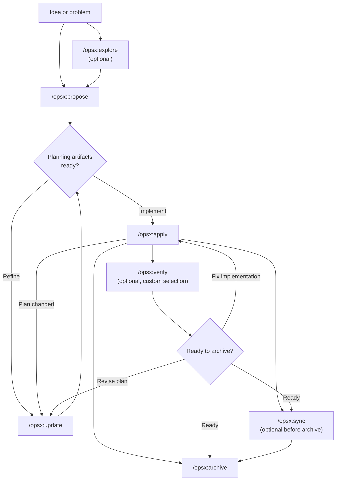
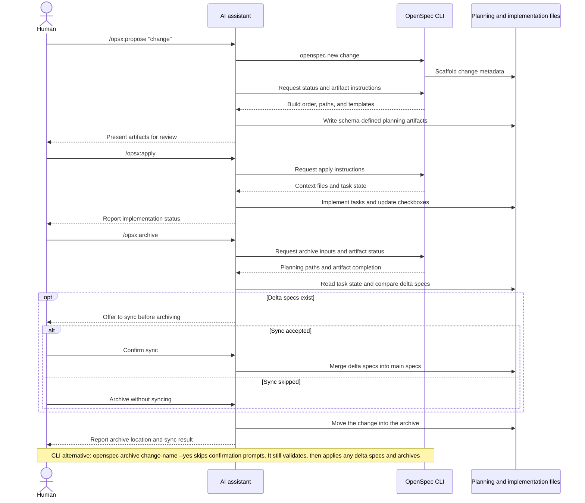

# Workflows {#workflows}

本指南介绍 OpenSpec 的常见 workflow（工作流）模式，以及每种模式适用于什么场景。基础安装设置请参见 [入门](getting-started.md)。命令参考请参见 [命令](commands.md)。

## 理念：动作，而非阶段 {#workflows-2}

传统 workflow 强迫你按阶段推进：先计划，再实现，最后完成。但真实的工作并不总能整齐地装进这些框里。

OPSX 走了另一条路：

```text
Traditional (phase-locked):

  PLANNING ────────► IMPLEMENTING ────────► DONE
      │                    │
      │   "Can't go back"  │
      └────────────────────┘

OPSX (fluid actions):

  proposal ──► specs ──► design ──► tasks ──► implement
```

**核心原则：**

- **动作，而非阶段** —— 命令是你可以去做的事，而不是你被困在其中的阶段
- **依赖是使动条件** —— 依赖展示的是哪些事情有可能做，而不是接下来必须做什么

> **自定义：** OPSX workflow 由定义 artifact 顺序的 schema 驱动。创建自定义 schema 的细节请参见 [自定义](customization.md)。

## 一览 Workflow {#workflow}

默认 workflow 保持流动：探索与验证都是可选的，并且
当实现过程揭示出新情况时，你可以随时更新规划类 artifact。



AI 助手驱动 workflow，而 CLI 提供确定性的脚手架、状态与
artifact 指令：



## 两种模式 {#workflows-4}

### 默认快捷路径（`core` profile） {#core-profile}

新安装默认使用 `core`，它提供：

- `/opsx:explore`
- `/opsx:propose`
- `/opsx:apply`
- `/opsx:update`
- `/opsx:sync`
- `/opsx:archive`

典型流程：

```text
/opsx:explore ──► /opsx:propose ──► /opsx:apply ──► /opsx:sync ──► /opsx:archive
  (optional)
```

#### 从探索开始（值得养成的习惯） {#workflows-6}

`/opsx:explore` 属于默认 profile，而不是高级附加功能。每当你有了问题但还没有方案时，就该这么做——而在有 AI 助手的条件下，这种情况占大多数。

```text
You: /opsx:explore

AI:  What would you like to explore?

You: Our search results feel stale. I'm not sure if it's caching,
     indexing, or the query itself.

AI:  Let me look... [reads the search service and cache layer]
     It's the index: it only rebuilds nightly, so edits don't show
     up until the next day. Two options: rebuild on write (simple,
     more load) or a short-TTL cache invalidation (more moving parts,
     less load). Given your write volume is low, rebuild-on-write is
     the cleaner fix. Want to scope it?

You: Yes.

You: /opsx:propose rebuild-search-index-on-write
```

探索从不写代码，也不会写其他任何东西，除非你要求它写，或者它主动提议时你表示同意。这是一段没有负担、不带风险的对话，把模糊的担忧转化为精确的 change，因此随后的 proposal 会更加锐利。已经确切知道自己想要什么？跳过它，直接去 `/opsx:propose`。完整指南：[先探索](explore.md)。

### 扩展/完整 Workflow（自定义选择） {#workflow-2}

如果你想要显式的“脚手架—构建”类命令（`/opsx:new`、`/opsx:continue`、`/opsx:ff`、`/opsx:verify`、`/opsx:bulk-archive`、`/opsx:onboard`），可以用以下方式启用：

```bash
openspec config profile
openspec update
```

## Workflow 模式（扩展模式） {#workflow-3}

### 快速特性开发 {#workflows-9}

当你明确知道要构建什么、只需要执行时：

```text
/opsx:new ──► /opsx:ff ──► /opsx:apply ──► /opsx:verify ──► /opsx:archive
```

**对话示例：**

```text
You: /opsx:new add-logout-button

AI:  Created openspec/changes/add-logout-button/
     Ready to create: proposal

You: /opsx:ff

AI:  Creating all planning artifacts...
     ✓ proposal.md
     ✓ specs/
     ✓ design.md
     ✓ tasks.md
     Ready for implementation!

You: /opsx:apply

AI:  Working through tasks...
     ✓ Added logout button to header
     ✓ Implemented session clearing
     ✓ Added confirmation dialog
     All tasks complete!

You: /opsx:archive

AI:  ✓ Merged specs
     ✓ Archived change
```

**最适合：** 中小型特性、缺陷修复、直截了当的改动。

### 探索式 {#workflows-10}

当需求不明确，或者你需要先做调查时：

```text
/opsx:explore ──► /opsx:new ──► /opsx:continue ──► ... ──► /opsx:apply
```

**对话示例：**

```text
You: /opsx:explore

AI:  What would you like to explore?

You: I want to improve page load performance but I'm not sure
     where the bottlenecks are.

AI:  Let me help investigate...
     [Analyzes bundle sizes, identifies slow queries, reviews
     component render patterns]

     I found three main bottlenecks:
     1. Large unoptimized images
     2. Synchronous data fetching in ProductList
     3. Re-renders from context changes

     Which would you like to address first?

You: Let's tackle the data fetching issue.

You: /opsx:new optimize-product-list-fetching

AI:  Created change. Ready to create: proposal

You: /opsx:continue

AI:  Creating proposal based on our exploration...
     [Writes proposal incorporating investigation insights]

     Ready to create: specs, design
     Which would you like next?

You: /opsx:continue

AI:  Creating specs...
```

**最适合：** 性能优化、调试、架构决策、需求不明确的情况。

### 并行 Change {#parallel-changes}

同时推进多个 change：

```text
Change A: /opsx:new ──► /opsx:ff ──► /opsx:apply (in progress)
                                         │
                                    context switch
                                         │
Change B: /opsx:new ──► /opsx:ff ──────► /opsx:apply
```

**对话示例：**

```text
You: I'm working on add-dark-mode but got pulled into a bug fix

You: /opsx:new fix-login-redirect

AI:  Created openspec/changes/fix-login-redirect/

You: /opsx:ff

AI:  ✓ Created planning artifacts

You: /opsx:apply

AI:  Working on fix-login-redirect...
     [Implements the fix]
     All tasks complete!

You: /opsx:archive

AI:  ✓ Archived fix-login-redirect

You: Let's get back to dark mode

You: /opsx:apply add-dark-mode

AI:  Resuming add-dark-mode...
     Picking up at task 2.3: Update Header...
```

**最适合：** 并行工作流、紧急插入的任务、团队协作。

当你有多项已完成的 change 时，使用 `/opsx:bulk-archive`：

```text
You: /opsx:bulk-archive

AI:  Found 3 completed changes:
     - add-dark-mode (all tasks done)
     - fix-login-redirect (all tasks done)
     - update-footer (all tasks done)

     Checking for spec conflicts...
     ⚠ add-dark-mode and update-footer both touch specs/ui/

     Inspecting codebase to resolve...
     Both changes are implemented. Will apply in chronological order.

     Archive all 3 changes?

You: Yes

AI:  ✓ Archived add-dark-mode
     ✓ Archived fix-login-redirect
     ✓ Archived update-footer
     Specs merged in order: add-dark-mode → update-footer
```

批量归档会检测多个 change 是否触及同一批 spec，并通过检查实际已实现的内容来解决冲突。

### 完成一个 Change {#change}

推荐的完成流程：

```text
/opsx:apply ──► /opsx:verify ──► /opsx:archive
                    │                 │
              validates          prompts to sync
              implementation     if needed
```

#### 验证：检查你的工作 {#verify-check-your-work}

`/opsx:verify` 会从三个维度校验实现与你的 artifact 是否一致：

```text
You: /opsx:verify

AI:  Verifying add-auth...

     COMPLETENESS
     ✓ All 12 tasks in tasks.md are checked
     ✓ All requirements in specs have corresponding code
     ⚠ Scenario "Session timeout after inactivity" not tested

     CORRECTNESS
     ✓ Implementation matches spec intent
     ✓ Edge cases from scenarios are handled
     ✓ Error states match spec definitions

     COHERENCE
     ✓ Design decisions reflected in code structure
     ✓ Naming conventions consistent with design.md
     ⚠ Design mentions "event-driven" but implementation uses polling

     SUMMARY
     ─────────────────────────────
     Critical issues: 0
     Warnings: 2
     Ready to archive: Yes (with warnings)

     Recommendations:
     1. Add test for session timeout scenario
     2. Consider refactoring to event-driven as designed, or update design.md
```

**验证会检查什么：**

| 维度   | 校验内容                                                   |
| ------ | ---------------------------------------------------------- |
| 完整性 | 所有 task 已完成、所有 requirement 已实现、scenario 已覆盖 |
| 正确性 | 实现符合 spec 的意图、边界情况已处理                       |
| 一致性 | 设计决策体现在代码中、模式保持一致                         |

验证不会阻断归档，但它会暴露你可能想先处理的问题。

#### 归档：为 Change 收尾 {#change-2}

`/opsx:archive` 会完成该 change 并将其移入 archive：

```text
You: /opsx:archive

AI:  Archiving add-auth...

     Artifact status:
     ✓ proposal.md exists
     ✓ specs/ exists
     ✓ design.md exists
     ✓ tasks.md exists (12/12 tasks complete)

     Delta specs: Not yet synced to main
     → Would you like to sync now?

You: Yes

AI:  ✓ Synced specs to openspec/specs/auth/spec.md
     ✓ Moved to openspec/changes/archive/2025-01-24-add-auth/

     Change archived successfully.
```

如果 spec 尚未同步，归档会提示你。它不会因为 task 未完成而阻断，但会给出警告。

## 何时使用哪一种 {#workflows-15}

### `/opsx:ff` 与 `/opsx:continue` {#opsxff-vs-opsxcontinue}

| 情形                              | 使用             |
| --------------------------------- | ---------------- |
| 需求清晰、准备开始构建            | `/opsx:ff`       |
| 正在探索、希望逐步审阅            | `/opsx:continue` |
| 想在 spec 之前先反复打磨 proposal | `/opsx:continue` |
| 时间紧迫、需要快速推进            | `/opsx:ff`       |
| 复杂 change、希望保持控制         | `/opsx:continue` |

**经验法则：** 如果你能事先描述完整范围，就用 `/opsx:ff`。如果你是边做边弄清范围，就用 `/opsx:continue`。

### 何时更新，何时重新开始 {#when-to-update-vs-start-fresh}

一个常见问题：什么时候更新既有 change 是可以的，什么时候应该开一个新的？

**在以下情况更新既有 change：**

- 意图不变，只是细化执行方式
- 范围收窄（先做 MVP，其余以后再说）
- 基于认知修正（代码库并不像你预期的那样）
- 根据实现中的发现调整设计

**在以下情况开启新的 change：**

- 意图发生了根本变化
- 范围膨胀，变成了完全不同的工作
- 原始 change 可以单独标记为“完成”
- 打补丁带来的困惑多于澄清

```text
                     ┌─────────────────────────────────────┐
                     │     Is this the same work?          │
                     └──────────────┬──────────────────────┘
                                    │
                 ┌──────────────────┼──────────────────┐
                 │                  │                  │
                 ▼                  ▼                  ▼
          Same intent?      >50% overlap?      Can original
          Same problem?     Same scope?        be "done" without
                 │                  │          these changes?
                 │                  │                  │
       ┌────────┴────────┐  ┌──────┴──────┐   ┌───────┴───────┐
       │                 │  │             │   │               │
      YES               NO YES           NO  NO              YES
       │                 │  │             │   │               │
       ▼                 ▼  ▼             ▼   ▼               ▼
    UPDATE            NEW  UPDATE       NEW  UPDATE          NEW
```

**示例：“添加暗色模式”**

- “还需要支持自定义主题” → 新 change（范围膨胀）
- “系统偏好检测比预期更难” → 更新（意图相同）
- “先把开关上线，之后再补偏好设置” → 先更新再归档，然后开新 change

## 最佳实践 {#workflows-18}

### 保持 Change 聚焦 {#change-3}

一个 change 对应一个逻辑工作单元。如果你在做“添加特性 X 顺便重构 Y”，考虑拆成两个独立的 change。

**为什么重要：**

- 更易于审阅和理解
- archive 历史更干净
- 可以独立发布
- 需要时回滚更简单

### 需求不明确时使用 `/opsx:explore` {#opsxexplore}

在正式立项之前，先探索问题空间：

```text
You: /opsx:explore

AI:  What would you like to explore?

You: How should we handle rate limiting for our API?

AI:  Let me investigate your current setup and options...
     [Researches codebase, considers patterns]

     I see three approaches we could take:
     1. Middleware-based (simple, per-endpoint)
     2. Redis-backed (scalable, shared state)
     3. Token bucket per user (fair, complex)

     Your current stack suggests #1 or #2. What's your scale?
```

探索能在任何代码写出之前理清思路。

### 归档前先验证 {#workflows-21}

使用 `/opsx:verify` 检查实现与 artifact 是否一致：

```text
You: /opsx:verify

AI:  Verifying add-dark-mode...

     ✓ All tasks in tasks.md are checked
     ✓ Requirements in specs have corresponding code
     ✓ Design decisions are reflected in implementation

     Ready to archive!
```

在结项之前发现不一致之处。

### 清晰命名 Change {#change-4}

好的名字能让 `openspec list` 有价值：

```text
Good:                          Avoid:
add-dark-mode                  feature-1
fix-login-redirect             update
optimize-product-query         changes
implement-2fa                  wip
```

## 命令速查 {#workflows-23}

完整的命令细节与选项请参见 [命令](commands.md)。

| 命令                 | 用途                          | 何时使用                                           |
| -------------------- | ----------------------------- | -------------------------------------------------- |
| `/opsx:propose`      | 创建 change 及规划类 artifact | 快速默认路径（`core` profile）                     |
| `/opsx:explore`      | 与 AI 一起梳理想法            | 不确定时从这里开始：需求不明确、需要调查、比较方案 |
| `/opsx:new`          | 启动 change 脚手架            | 扩展模式、需要显式控制 artifact                    |
| `/opsx:continue`     | 创建下一个 artifact           | 扩展模式、逐步创建 artifact                        |
| `/opsx:ff`           | 创建全部规划类 artifact       | 扩展模式、范围清晰                                 |
| `/opsx:apply`        | 实现 task                     | 准备写代码时                                       |
| `/opsx:verify`       | 校验实现                      | 扩展模式、归档之前                                 |
| `/opsx:sync`         | 合并 delta spec               | 扩展模式、可选                                     |
| `/opsx:archive`      | 完成 change                   | 所有工作结束                                       |
| `/opsx:bulk-archive` | 批量归档多个 change           | 扩展模式、并行工作                                 |

## 后续步骤 {#workflows-24}

- [编写优质 Spec](writing-specs.md) —— 强健的 requirement 与 scenario 长什么样，以及如何把握 change 的合适粒度
- [审阅 Change](reviewing-changes.md) —— 在写任何代码之前，用两分钟过一遍已起草的计划
- [团队中的 OpenSpec](team-workflow.md) —— change 如何配合分支与 pull request
- [命令](commands.md) —— 含选项的完整命令参考
- [概念](concepts.md) —— 深入理解 spec、artifact 与 schema
- [自定义](customization.md) —— 创建自定义 workflow
